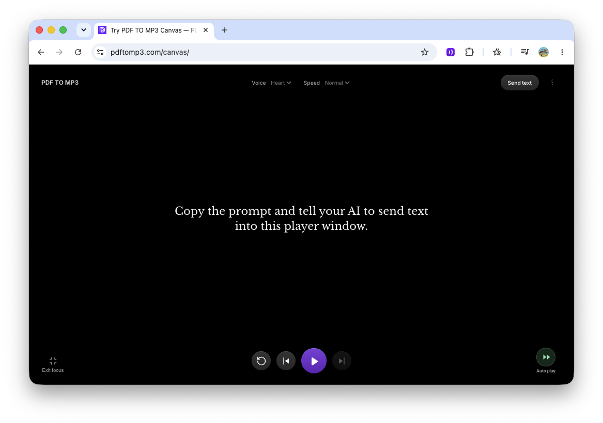

# PDFTOMP3 Text Player Canvas

PDFTOMP3-Canvas is a free text player for AI agents. It uses text-to-speech. The AI sends text into the canvas, and the user can listen sentence by sentence.

Example: [Try the player](https://pdftomp3.com/canvas/)

## Use from your AI

Paste this prompt into an AI that can read web pages and send requests:

```text
Instructions for the AI:

Please send text into this player.
Read https://pdftomp3.com/canvas/guide.html.
Show or open the player link.

My text or request:
[Add your text / request here.]
```



Canvas opens a saved example when its address has no reading ID.
The saved example uses Kokoro's Heart voice and the word times from the same speech request.
Playback needs no server speech request.
It includes no Ask or Explain buttons.

Choose **Upload text** in the toolbar. Copy the prompt into your AI.
Add your task or source text. Your AI creates a reading and returns its player link.

The guide explains the JSON format and how to send text. It also gives optional tips for readings and teacher explanations.

The AI agent needs to:

1. Prepare the spoken text.
2. Send it to the server in the required JSON format, as shown in the guide.
3. Open the returned link so the user can listen.

Users need no account or plugin. Anyone with the link can read the text.

## Speech and privacy

- Speech uses Kokoro on the server. Users need no speech key. The browser calls the Canvas server, which calls the speech service. The service key stays on the server.
- Canvas prepares the current sentence and up to two ahead. Changing the voice does not rebuild speech for the whole reading.
- Word highlights use the times Kokoro returns with the speech.
- Ask and Explain are not included. Speed stays at Normal.
- Audio and reading position stay in your browser. Text stays on the server, so the same link works on other devices. Canvases do not expire.

## Local use

Needs Node.js 20 or newer and a running MongoDB.
In the separate Canvas repo, copy `node/.env.example` to `node/.env`.
In the main repo, use `canvas/env.example` as the source.
Set `FREETTS_URL` and `FREETTS_SECRET` for your Kokoro service.
Keep `node/.env` out of Git. The example settings use local port 3000.

From the repository root:

```sh
npm --prefix node install
npm --prefix node start
```

Open [Canvas](http://localhost:3000/canvas/) or the [AI guide](http://localhost:3000/canvas/guide.html).


## Review the source

The browser code is in `web/canvas/`. The server code is in `node/src/canvas/`.
To check speech, read `canvas.js` and `free-speech.js` in the browser folder.
Then read `freeSpeech.js` in the server folder.

From the main PDFTOMP3 project, export just Canvas with `node canvas/export.mjs /tmp/pdftomp3-canvas`. The output folder must not exist yet.

The export copies the player, server code, shared styles, assets, and this README.
It creates a small package list and example settings. It does not deploy the site.
The saved Gemini page stays in `canvas/gemini` in the main repo and `archive/gemini` in the export.

To make the saved example again, run `node node/tasks/generateCanvasExampleAudio.js`.
The task uses the server's free speech settings. It saves each recording with its Kokoro word times.
